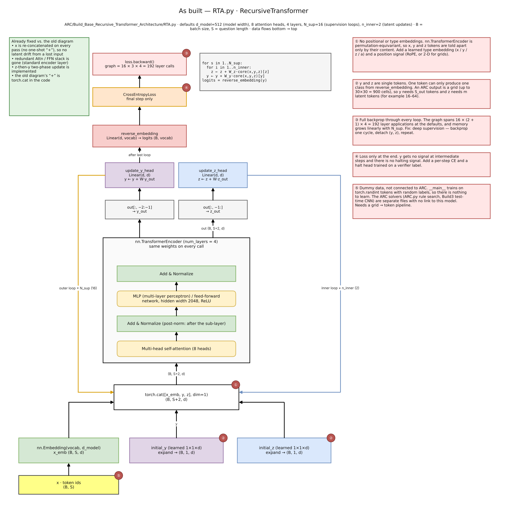
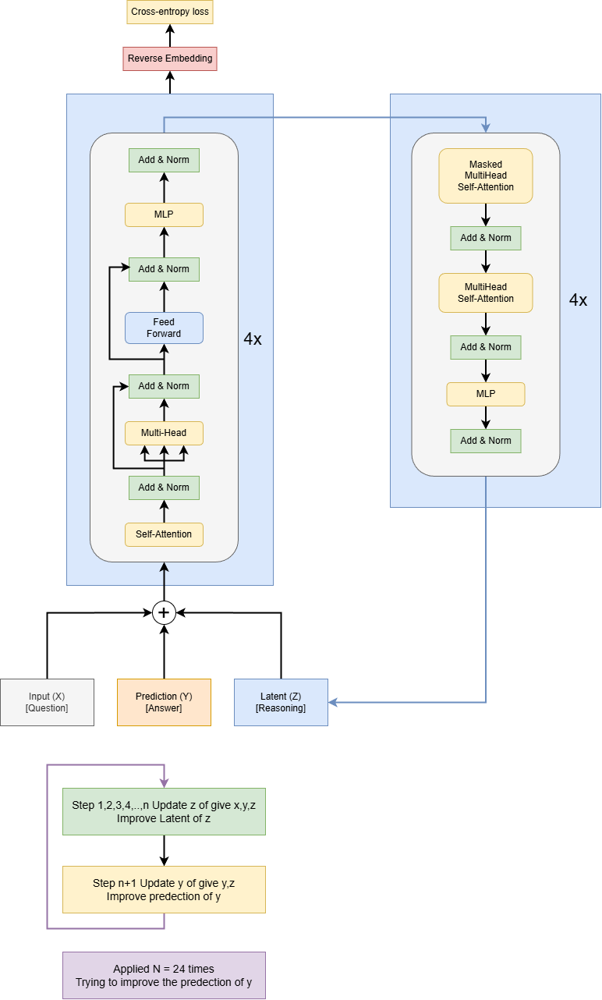
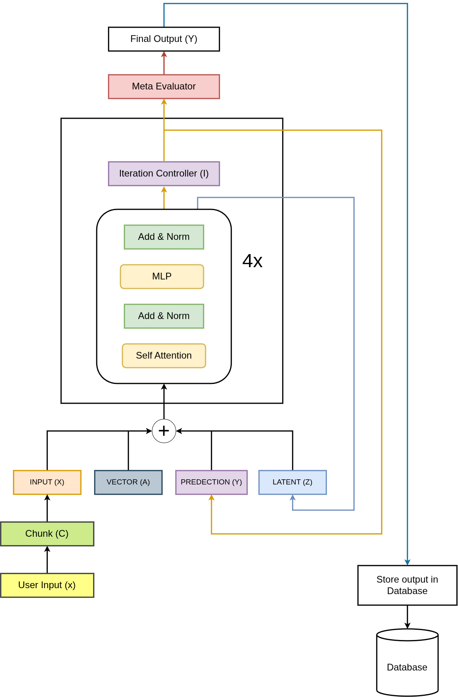
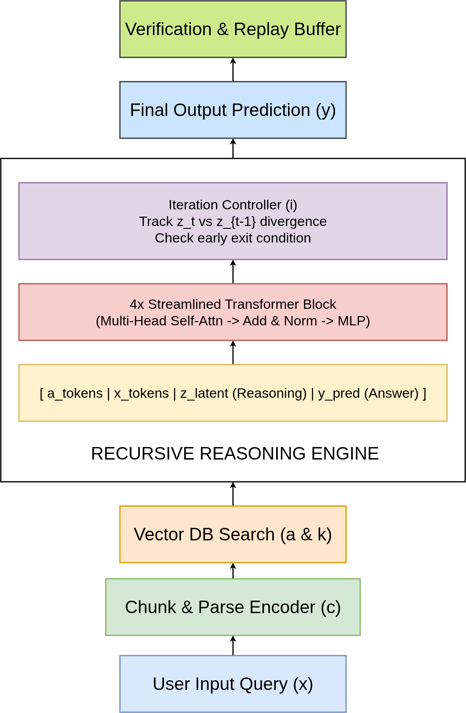
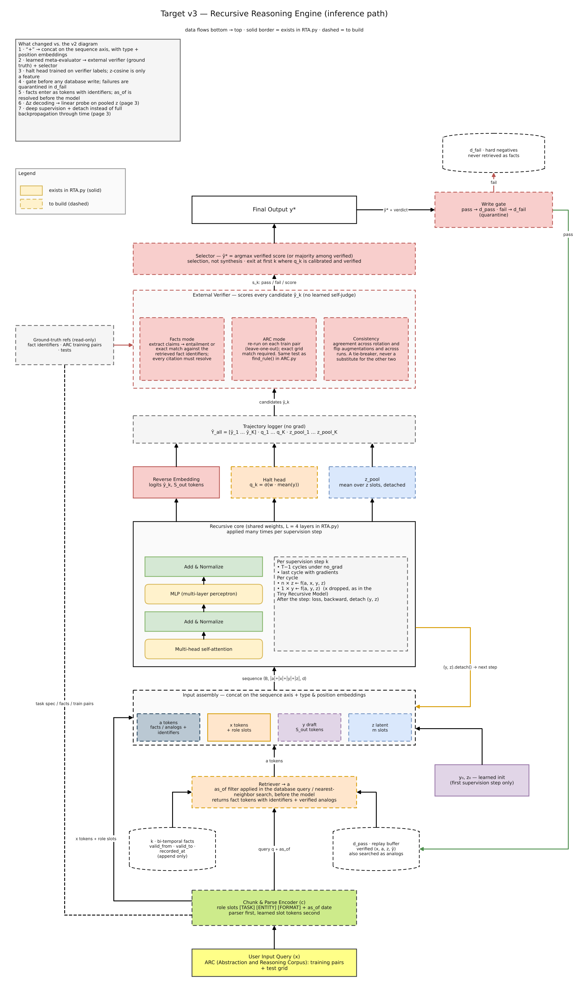
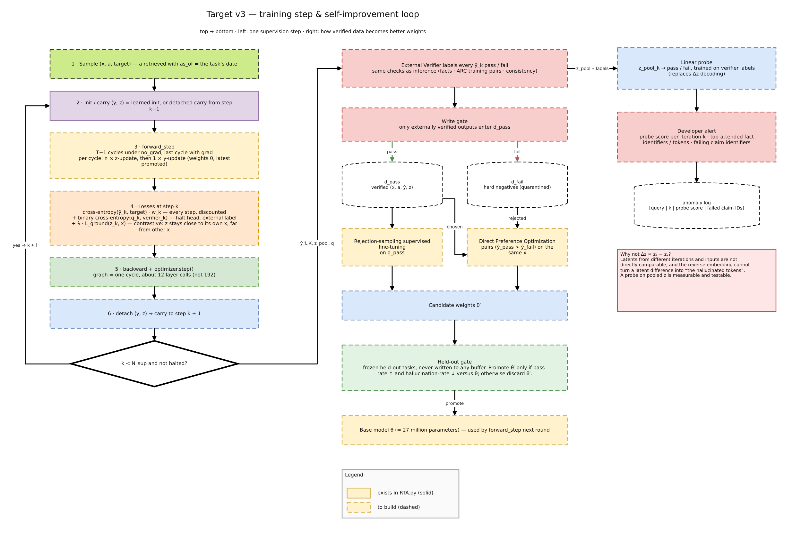

# Verified Recursive Reasoning for ARC-AGI-2

*An experimental approach to novel grid problems through recursive proposals and external verification*

> **Submission status:** ARC-AGI-2 public leaderboard score: **0.00**. This is an honest report of an early system, not a claim of competitive ARC performance.



## Summary

The Abstraction and Reasoning Corpus (ARC) tests whether a system can infer a transformation from a few input-output examples and apply it to a new grid. This submission explores a verifier-centered approach: a recursive transformer proposes answers, while symbolic search proposes candidate grid programs. An external check tests candidates against the task demonstrations. The system’s central principle is that model confidence is not evidence of correctness.

The recursive core and symbolic search are prototypes. The full retrieval, verification, gated-memory, and retraining loop is not yet a completed system. The reported ARC-AGI-2 public-evaluation score is **0.00**.

## Approach

### Recursive core

The model repeatedly updates three values: `x`, the task (demonstrations and test grid); `y`, a draft answer; and `z`, a hidden state intended to support reasoning. A shared four-layer transformer is reused across steps. Task, answer, and state are concatenated along the sequence axis rather than added, preserving them as distinct inputs.

```python
for s in range(N_sup):
    for _ in range(n_inner):
        z = z + W_z(core(cat[x, y, z])[z])
    y = y + W_y(core(cat[x, y, z])[y])
```

The implementation uses width 512, eight attention heads, four layers, 16 outer steps, and two hidden-state updates per step—about 14 million parameters. It does not yet have position or type embeddings, and `y` and `z` are single tokens, insufficient for directly representing a full ARC grid.


### From the first design to the current design

The initial sketch added task, answer, and state together and repeated redundant blocks. The revised core concatenates them and reuses one standard transformer block. This keeps roles distinguishable and shares parameters across reasoning steps. Deep supervision and detaching intermediate states are planned, but the current code still backpropagates through the full loop.



The following two archived sketches show earlier controller and reasoning-engine concepts. They are included for design history; their learned evaluator and hidden-state-difference decoding were not retained as the final proposal.





### Target inference and training loop

The target system is a design, not an integrated implementation. It would parse a task, optionally retrieve relevant verified examples, run the recursive core, log candidate answers, and pass candidates to an external verifier. For ARC, a candidate program must reproduce every demonstration pair. The verifier can reject inconsistent candidates, but matching a few examples does not prove a rule will generalize to every unseen grid. A selector would choose among candidates that pass; it would not combine drafts into a new answer.



The proposed training loop would apply losses at multiple reasoning steps and train a halting signal from verifier labels. Verified results could enter a pass buffer; failures would be quarantined. Any updated model would be promoted only if it improved on a frozen held-out set. These memory and promotion mechanisms remain planned work.



## Rationale

A candidate that fails an observed demonstration is inconsistent with the task, providing a useful check without trusting the model’s self-assessed confidence. Reusing shared weights also allows more computation through repeated updates without adding a separate transformer for every step. Finally, gating memory writes is intended to reduce feedback from unchecked model outputs.

These are motivations, not proof of improved ARC accuracy. A small set of examples can fit multiple rules, a limited operation library can omit the intended rule, and recursion can stabilize on an incorrect answer. Verification filters candidates; it does not itself generate a correct candidate or guarantee generalization.

## Results

The ARC-AGI-2 Kaggle leaderboard entry reports **0.00**. The notebook and leaderboard are available here:

- [Public ARC-AGI-2 notebook](https://www.kaggle.com/code/codingmaster24/arc-prize-2026-arc-agi-2-v1?scriptVersionId=335699879)
- [ARC-AGI-2 leaderboard](https://www.kaggle.com/competitions/arc-prize-2026-arc-agi-2/leaderboard)

Small development experiments are not benchmark results: a convolutional baseline failed to exactly solve a synthetic 3×3 “add one” task; a small symbolic solver succeeded on a trivial example; and the 48-rule search has 21 placeholder rules. The recursive core’s random-data demonstration does not show that it learns ARC. These experiments do not support a claim of ARC generalization.

## Limitations and next steps

The public score is zero. The core’s grid representation is incomplete; the full verifier-gated memory system is not integrated; and the symbolic library is limited. The next steps are to add grid, position, and type representations; train and evaluate across real ARC tasks; compare recursive training variants; and measure whether external verification improves exact-match performance. Future memory-based training should use a held-out set that never enters the training buffer.

## Reproducibility

- **Code:** [Sivatech24/Project-Intelligence](https://github.com/Sivatech24/Project-Intelligence) (Apache License 2.0)
- **Notebook:** [ARC-AGI-2 public notebook](https://www.kaggle.com/code/codingmaster24/arc-prize-2026-arc-agi-2-v1?scriptVersionId=335699879)

The notebook should be attached as the public Project Link in Kaggle. Add a cover image and the relevant figures to the Kaggle Media Gallery as required by the competition; embedded images in this Markdown may not automatically populate the gallery.
