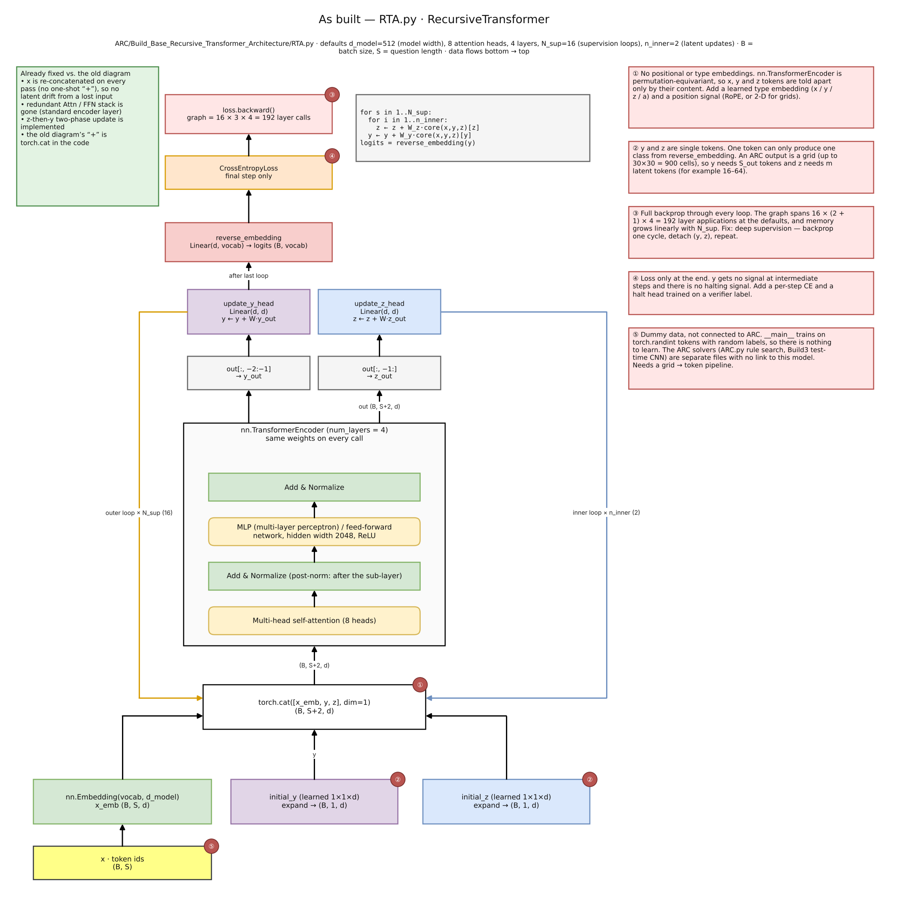
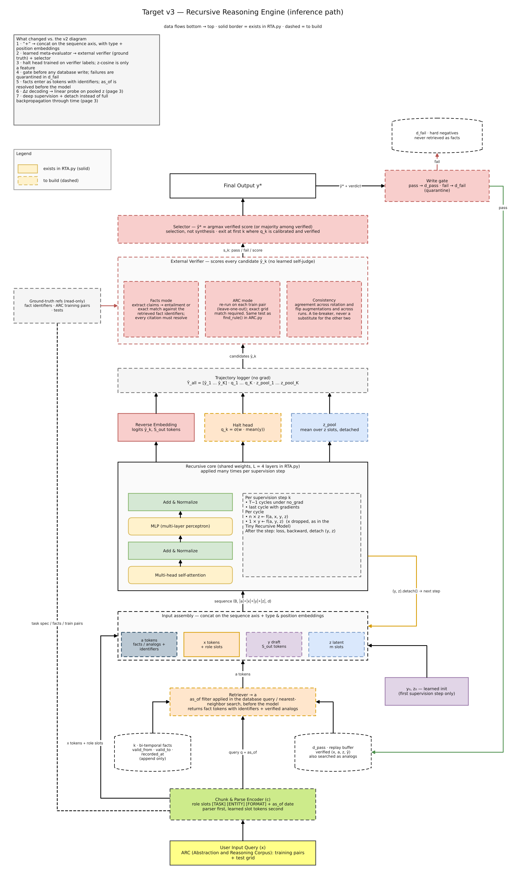

## Summary

Real intelligence is knowing what to do when the problem changes. This writeup describes **True Intelligence**, a recursive-reasoning system for the Abstraction and Reasoning Corpus (ARC) whose one rule is: *nothing the model produces is trusted until something outside the model has checked it.* It covers the design, what is built, and an honest status report.

**Status in one line:** the recursive core, the verifier, the write gate and a verified program search are implemented at demo scale; the full system is a design; the measured score on the ARC-AGI-2 public evaluation set is **0 / 167 test outputs**. I report that number as it is.

## 1. The idea

ARC tasks are small colored-grid puzzles, new every time, so memorized patterns do not transfer. A solver must infer a hidden rule from two to four examples and apply it to a new grid. Humans do this by proposing a rule, checking it against every example, and discarding it if it fails. The system copies that loop.

Three variables carry the loop: `x`, the task (the demonstration pairs and the test grid); `y`, a draft answer; `z`, a hidden "reasoning" state. One small transformer, with shared weights, is applied many times, each time refining `z` and then `y`. This follows the Tiny Recursive Model (TRM) and Hierarchical Reasoning Model (HRM) line of work, and the earlier Universal Transformer.

## 2. How it works

**Recursive core (implemented, about 14 million parameters).**

```python
for s in range(N_sup):              # improve the answer
    for _ in range(n_inner):        # improve the hidden state
        z = z + W_z(core(cat[x, y, z])[z])
    y = y + W_y(core(cat[x, y, z])[y])
```

One four-layer transformer (width 512, 8 heads) is reused every pass. The inputs are joined along the **sequence axis**, not added. My first design summed `x`, `y` and `z` before the network; that forces three different kinds of information into one vector and the model cannot tell question from reasoning. Joining them keeps them separable. `x` is re-inserted on every pass so `z` cannot drift away from the task.



**Four problems found in my first design, and the fixes.**

1. *Addition of x, y, z* destroys information. Fix: concatenation (done).
2. *Duplicate attention and feed-forward blocks* add depth without power. Fix: one standard block (done).
3. *Backpropagation through every loop* spans about 192 layer calls (16 × 3 × 4) and runs out of memory. Fix: deep supervision, which backpropagates one cycle, detaches `(y, z)`, and repeats (designed; the code still backpropagates through everything).
4. *Loss only on the last step* gives no signal to early drafts. Fix: a discounted loss at every step (designed).

**The verifier-centred target system (designed).** Retrieve relevant past solutions and time-stamped facts; run the recursion while logging every draft `ŷ_k`; then verify with an **external** scorer. In ARC mode a candidate must reproduce *every* demonstration pair, and neural candidates are re-checked by leaving one pair out at a time. The best verified candidate is selected; verified results go to a "pass" buffer and failures to a "fail" buffer that is never retrieved as fact. Periodically the model is fine-tuned on the pass buffer (rejection sampling, plus Direct Preference Optimization on verified-versus-failed pairs) and the new weights are accepted only if a frozen held-out set improves.



**Ideas from my first proposal that I dropped, and why.** A learned "meta-evaluator" that merges the best iterations has no ground truth, so it can only copy the model's confidence; I replaced it with an external verifier and a selector. Decoding `Δz = z₃ − z₂` into "the hallucinated tokens" is not meaningful, because hidden states from different steps are not directly comparable; I replaced it with a linear probe trained on verifier pass/fail labels. Exiting early when `z` stops changing can lock in a stable wrong answer; I use a halting head trained on verifier labels instead. Writing every output to memory feeds hallucinations back into training; a write gate prevents that.

## 3. Why it should work

*Checking is easier than guessing.* For ARC, a proposed rule can be tested exactly on the demonstrations. A candidate that fails any demonstration is wrong with certainty, so the verifier gives a signal the network cannot fake. This is why verified selection, not a learned judge, sits at the end.

*Shared weights give depth without parameters.* Reusing one block lets a tiny model do many reasoning steps, which is the empirical finding of TRM and HRM on ARC-style puzzles.

*Separating logic from facts avoids forgetting.* Model weights learn how to reason; time-stamped facts live in a database that is appended to, never overwritten. A new fact is a new row, not a weight update, so learning it cannot erase reasoning ability.

*Closed loops need a gate.* A model retrained on its own unchecked outputs amplifies its errors. Admitting only verified results, and promoting weights only on a held-out improvement, breaks that feedback.

These are design arguments. Only the first is supported by a measurement below.

## 4. How well it performs

**Recursive core with verifier and write gate (demo scale).** I trained the recursive core per task from scratch (grid tokenizer with 3×3 neighbourhoods, deep supervision, halt head) on 60 same-shape public ARC training tasks (63 test outputs), holding out each task's last demonstration as the external verifier. Result: **4 / 63 test outputs solved** (copying the input solves 0). The verifier did not raise accuracy here: voting over all candidates and voting over verified candidates both find the same 4, and no unverified candidate was correct in the other tasks. What it did change is the memory buffer: without the write gate only **6.3 %** of entries (4 of 63) are correct; with the gate (verified outputs only) **75 %** (3 of 4). The halt head separates right from wrong drafts with AUROC 0.93. This confirms the gate's purpose, not a competitive score; a model trained from scratch on three examples cannot infer, for instance, a colour that never appears in them. Code: `ARC/BuildVerified/trm_verified.py`.

A symbolic baseline on the same kind of data: a library of 71 grid operations, programs of up to two steps, a rule kept only if it reproduces **every** demonstration pair, two attempts per test input.

| Solver | Public **evaluation** (167 outputs) | Public training, dev check only (1,076 outputs) |
|---|---|---|
| Existing 48 rules, chosen from the first pair only | 0 | 10 |
| Same rules, must match every pair | 0 | 11 |
| 71 operations, two-step programs, every-pair check | **0** | **58** |

On the evaluation set every variant scores zero: ARC-AGI-2 tasks need compositional reasoning that fixed simple operations do not reach, and not one task had a program consistent with all its demonstrations. On the easier, public training set, requiring every pair and enlarging the library raised the count from 10 to 58, which supports the verification argument but is a development check, not a result. **I have no ARC-AGI-2 leaderboard score and no ARC-AGI-3 score to report.**

## 5. How general it is

Task-independent by design: the recursive loop, the sequence-axis interface, the verifier interface (candidate in; pass, fail or score out), the write gate, and the pass/fail buffers. ARC-specific: the grid tokenizer and the demonstration-pair verifier. The same loop on another domain changes only the verifier: unit tests for code, or checking claims against time-stamped facts for question answering. These are hypotheses to test, not results.

## 6. Limitations

- The score is zero; the system does not currently solve ARC-AGI-2 tasks.
- The recursive core is trained from scratch per task and has not been pretrained across tasks; no demonstrations enter its context.
- Retrieval, the learned halting head, the write gate and the memory loop are designs.
- 21 of the 48 rules in the earlier search are placeholders.

## 7. Next steps

Pretrain one core across many tasks with demonstrations in context (retrieval `a`); use the verified search as the candidate source and the network as a proposal ranker; then add the held-out promotion gate and the memory loop.

## 8. Reproducibility

Code (Apache License 2.0): https://github.com/Sivatech24/Project-Intelligence. Notebooks: ⚠️ link to fill (`kaggle_notebook_recursive.ipynb` reproduces the recursive-core table; `kaggle_notebook.ipynb` the 0 / 167 figure). Neither needs a GPU.

## References

- Jolicoeur-Martineau, A. *Less is More: Recursive Reasoning with Tiny Networks* (TRM), 2025.
- Wang, G. et al. *Hierarchical Reasoning Model*, 2025.
- Dehghani, M. et al. *Universal Transformers*, 2019.
- Zelikman, E. et al. *Quiet-STaR*, 2024.
- Zou, A. et al. *Representation Engineering: A Top-Down Approach to AI Transparency*, 2023.
- Chollet, F. *On the Measure of Intelligence*, 2019.
