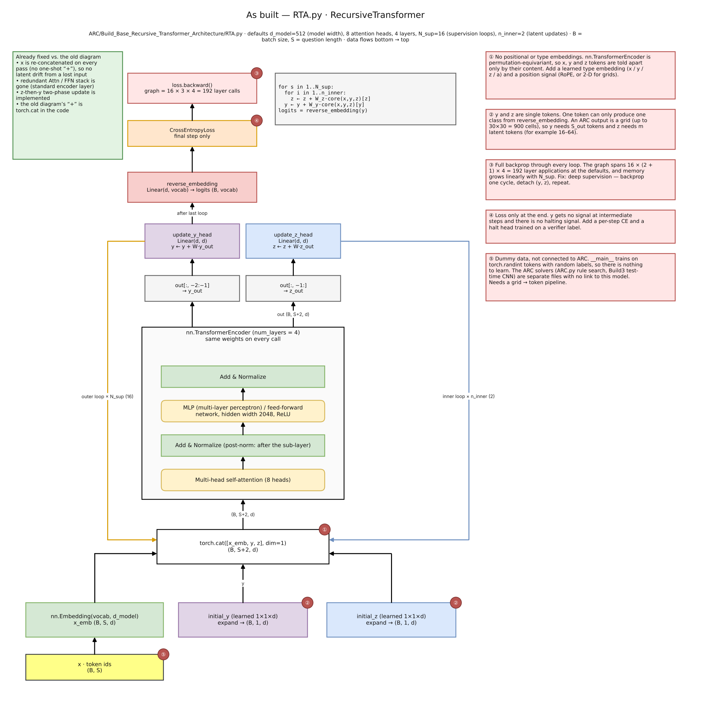
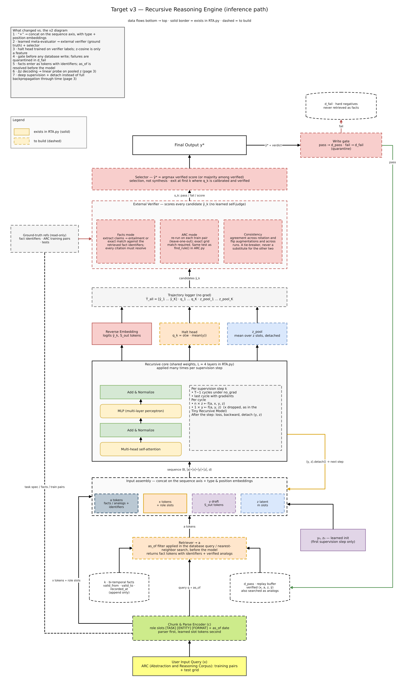
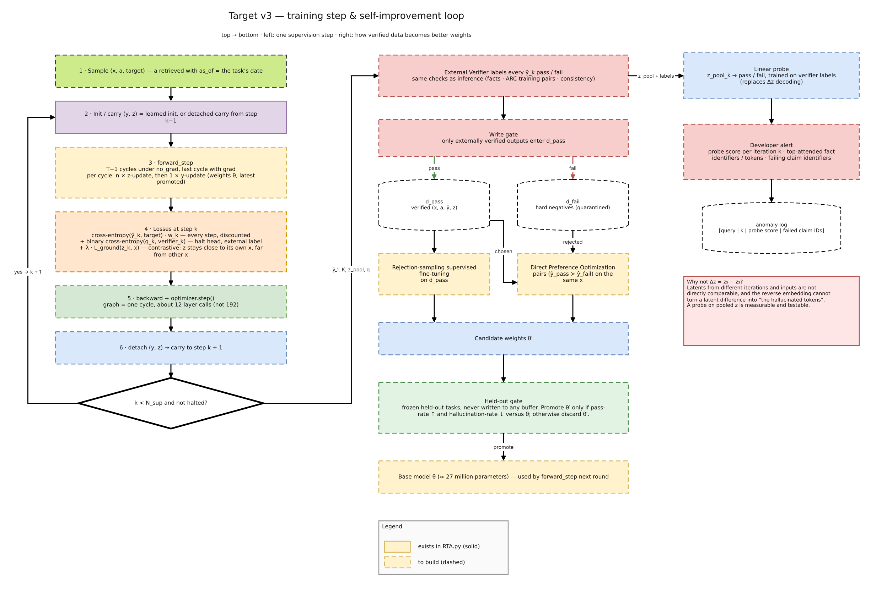

<!--
BEFORE YOU SUBMIT — delete this block
[ ] Fill every item marked ⚠️ (search the file for the warning sign): evaluation scores, notebook link, submission link, ORCID
[ ] Preview once: every figure must show. If a figure does not show on Kaggle, drag the PNG from Writeup/images/ into the editor
[ ] Deadline shown on your Kaggle page: Nov 10, 2026 at 5:29 AM (GMT+5:30)
-->

## Summary

- **Problem.** The Abstraction and Reasoning Corpus (ARC) is a set of visual puzzles that are new every time, so memorized patterns do not transfer. A solver must infer the hidden rule from a few examples and apply it.
- **Idea.** A tiny recursive transformer loops over `x` (the task), `y` (a draft answer) and `z` (a hidden reasoning state). Every candidate answer is scored by an **external verifier** before it is selected or remembered. Only verified results enter the memory that later retrains the model.
- **Built today.** The recursive core ([`RTA.py`](https://github.com/Sivatech24/Project-Intelligence/blob/main/ARC/Build_Base_Recursive_Transformer_Architecture/RTA.py); RTA stands for Recursive Transformer Architecture; about 14 million parameters) and symbolic rule-search baselines ([`ARC.py`](https://github.com/Sivatech24/Project-Intelligence/blob/main/ARC/BuildARC1/ARC.py): 48 rules, of which 27 work and 21 are placeholders).
- **Designed, not built yet.** Retrieval, the verifier, the write-gated memory, and deep-supervision training.
- **Results.** There is **no ARC public-evaluation score yet** (Section 6). Every design claim below is labeled as a design claim.

---

## 1. Introduction

ARC tests whether a system can solve a puzzle it has never seen. Each task gives a few input-to-output grid pairs; the solver must work out the transformation and apply it to a new grid [1]. A system that has memorized its training tasks fails by design.

This writeup answers four questions, in this order:

| Question | Section |
|---|---|
| How does the system work? | 4 |
| Why should it work? | 5 |
| How well does it perform? | 6 |
| How general is it? | 7 |

## 2. Related work

- The **Tiny Recursive Model (TRM)** [2] and the **Hierarchical Reasoning Model (HRM)** [3] show that a very small network, applied again and again to a hidden state and an answer with deep supervision, can do well on grid-reasoning tasks. Our core follows the Tiny Recursive Model's two-role schedule.
- **Universal Transformers** [4] share weights across depth. This is the same idea as our loop: depth comes from repetition, not from more parameters.
- **ARC Is a Vision Problem!** [5] and **test-time training for few-shot tasks** [6] motivate our vision-style baseline that adapts to each task at test time.
- The **Self-Taught Reasoner (STaR)** [7] and **Quiet-STaR** [8] train a model on its own verified reasoning. This is the pattern behind our memory loop. **Model collapse** [9] is the risk that loop must avoid.
- **Direct Preference Optimization (DPO)** [10] lets us learn from failures as well as successes. **Representation engineering** [11] motivates reading the hidden state with probes.
- **Retrieval-augmented generation (RAG)** [12] separates what a model knows from what it looks up.

## 3. Notation

| Symbol | Meaning |
|---|---|
| `x` | the task: a question, or for ARC the demonstration pairs plus the test grid |
| `y` | the current draft answer |
| `z` | the hidden reasoning state, carried from one cycle to the next |
| `a` | retrieved context added to the input (facts, or verified past solutions) |
| `k` | the time-stamped fact store that `a` is retrieved from |
| `c` | the chunk-and-parse step that turns raw input into tokens and role slots |
| `i` | the iteration log: every draft, halting score and pooled hidden state, per step |
| `d` | the database of verified results (`d_pass`) and quarantined failures (`d_fail`) |
| `n`, `T` | the number of hidden-state updates per cycle, and the number of cycles |
| `N_sup` | the number of supervision steps (outer loops) |

## 4. How the system works

### 4.1 The recursive core (implemented)

One shared four-layer transformer is reused for every update. Each pass joins the tokens end to end along the **sequence** axis instead of adding them together, so the model can tell the question from its own reasoning.

```python
for s in range(N_sup):                 # outer loop: improve the answer y
    for _ in range(n_inner):           # inner loop: improve the hidden state z
        z = z + W_z(core(cat[x, y, z])[z])
    y = y + W_y(core(cat[x, y, z])[y])
logits = reverse_embedding(y)          # cross-entropy loss on the final step only
```

Defaults in the code: model width 512, 8 attention heads, 4 layers, `N_sup = 16`, `n_inner = 2`. That is about 14 million parameters.



### 4.2 What the first design review found

The first diagram (Figure 2) added `x`, `y` and `z` together before the network and stacked redundant blocks. Reviewing that diagram and the code gives this status. ✅ means implemented in the code; 🔲 means planned.

| # | Problem in the first design | Fix | Status in the code today |
|---|---|---|---|
| 1 | Adding x, y and z lets them overwrite each other | Join them along the sequence axis | ✅ done with `torch.cat` |
| 2 | x enters only once, so z can drift away from it | Re-insert x on every pass; add a grounding loss on z | ✅ re-insertion · 🔲 grounding loss |
| 3 | Duplicate attention and feed-forward blocks | One standard block: attention, Add & Normalize, multi-layer perceptron (MLP), Add & Normalize | ✅ |
| 4 | Backpropagation through every loop spans about 192 layer calls (16 × 3 × 4) and exhausts memory | Deep supervision: backpropagate one cycle, detach `(y, z)`, repeat | 🔲 the code still backpropagates through everything |
| 5 | y is trained only at the last step | Two-phase update (z, then y) and a loss at every step | ✅ two-phase update · 🔲 loss at every step |

Two more gaps exist in the core. It has **no position or type embeddings**, so tokens of x, y and z are told apart only by their content. And **y and z are single tokens**, so it can only output one class, while an ARC answer is a grid of up to 900 cells.


### 4.3 The target system (designed)

In the figures, solid boxes exist in the repository and dashed boxes are still to be built.



1. **Parse (`c`).** Turn the grid or text into tokens with role slots such as `[TASK] [ENTITY] [FORMAT]`, plus an `as_of` date when a question depends on time.
2. **Retrieve (`a`).** Fetch from the time-stamped store `k` and from earlier verified solutions in `d_pass`. The time filter is applied in the database **before** the model sees anything, and facts arrive as tokens that carry identifiers.
3. **Assemble.** Join `[a | x | y | z]` and add type and position embeddings.
4. **Recurse.** Run `T` cycles: the first `T − 1` without gradients, the last with gradients. Each cycle does `n` updates of z (which see x, y and z) and one update of y (which sees y and z).
5. **Log (`i`).** For every step `k`, record the draft `ŷ_k`, the halting score `q_k`, and the pooled hidden state `z_k`. The full trajectory is kept. Early exit is an optional way to save compute and is off by default.
6. **Verify.** An **external** scorer, never the network itself:
   - *Facts mode:* extract claims and check each one against the retrieved fact identifiers; every citation must resolve.
   - *ARC mode:* a candidate program must reproduce **every** demonstration pair; neural candidates are re-checked by leaving one demonstration out at a time.
   - *Consistency:* agreement across rotations, flips and repeated runs, used only as a tie-breaker.
7. **Select.** Take the highest verified score. This is selection, not synthesis: a learned judge that merges drafts has no ground truth to learn from.
8. **Gate.** Verified results go to `d_pass`. Failures go to `d_fail` and are never retrieved as facts.

### 4.4 Training and self-improvement (designed)



- **Loss at step `k`:** a discounted cross-entropy loss on every step, plus a binary cross-entropy loss that teaches the halting head from the external verifier's labels, plus a contrastive grounding term that keeps `z` close to its own `x`.
- **Memory update:** rejection-sampling fine-tuning on `d_pass`, and Direct Preference Optimization on pairs (verified answer preferred over failed answer) for the same task.
- **Promotion rule:** the new weights replace the old ones only if a frozen held-out set, which never enters any buffer, improves. Otherwise they are discarded.

### 4.5 Ideas from the first proposal that we changed

| First proposal | Problem | Replacement |
|---|---|---|
| A learned meta-evaluator picks the best segments | It has no ground truth, so it can only copy the model's own confidence | External verifier plus a selector |
| Decode `Δz = z₃ − z₂` into "the hallucinated tokens" | Hidden states from different steps and inputs are not directly comparable, and the reverse embedding cannot turn a difference into tokens | A linear probe on the pooled hidden state, trained on verifier pass/fail labels and logged per step |
| Exit early when `z_t ≈ z_(t−1)` | A stable hidden state can be stable and wrong | A halting head trained on verifier labels |
| Write every output to the database | Feeds hallucinations back into training | A write gate |
| Compress timelines into dense vectors | Exact dates and numbers are lost | Keep facts as tokens with identifiers; resolve time in the database |

The earlier sketches are kept in Appendix A.

## 5. Why it should work

These are arguments, not measurements. Each one has a matching test in Section 6.

1. **Depth without parameters.** Reusing one block `n × T` times gives deep computation from a small parameter budget. A small model has less capacity to memorize training tasks, which is the failure ARC is designed to expose [2, 4].
2. **Checking is easier than generating.** ARC supplies exact demonstration pairs at test time. A candidate rule that fails any demonstration is wrong, and that test needs no learned judge. Spending compute on many candidates and keeping only verified ones turns extra compute into accuracy.
3. **Logic in the weights, facts outside.** Keeping time-sensitive facts in an append-only store means a changed fact never overwrites reasoning skill. This avoids catastrophic forgetting.
4. **The gate prevents collapse.** Training on a model's own output degrades it [9]. Admitting only externally verified outputs keeps the training data tied to something true.
5. **An honest limit.** Recursion improves reasoning over the context it is given; it does not create knowledge. A converged hidden state is not necessarily a correct one. That is why correctness comes from the verifier, not from convergence.

## 6. How well it performs

**There is currently no ARC public-evaluation or leaderboard result.** The competition asks for public-evaluation and leaderboard numbers, not training-set numbers, so none of the figures below are presented as ARC accuracy.

What the repository has actually measured, from the committed logs:

| Component | Setup | Observed | Reading |
|---|---|---|---|
| `PyTorch_ARC_Model.py` (small convolutional neural network, mean squared error loss) | synthetic 3×3 "add 1" rule, 10 full-batch epochs | loss 3.65, then 0.69 at epoch 5, then 0.84 at epoch 10 | It did not recover the rule: 5 of 9 cells were correct on the test grid, so the output was not an exact match. Ten steps is too few to judge capacity; this is a baseline, not a solution. |
| `ARC_Solver.py` (7 rules) | one training pair | finds `add_one` and applies it correctly to the test grid | Correct, on a trivial task. |
| `ARC.py` (48 rules) | one training pair | finds `add_one`; per-rule timing is logged | 27 rules work; 21 are placeholders that return the input unchanged. |
| `Hybrid ARC Solver.py` (test-time training with a convolutional network) | one training pair | prints a prediction | One pair under-determines the rule, so there is nothing to check the prediction against. This is the case for verifying by leaving one demonstration out. |
| `RTA.py` (recursive core) | the `__main__` block runs on random token identifiers and random labels | no logged run | The data is random, so there is nothing to learn yet. |

**Evaluation plan.** All numbers will come from the public evaluation set of ARC-AGI-2 (the second version of the Abstraction and Reasoning Corpus for Artificial General Intelligence), scored by exact match, over several random seeds.

| Run | Adds | Question it answers |
|---|---|---|
| A | recursive core, a real grid tokenizer, position and type embeddings | Does it learn at all? |
| B | A plus deep supervision with detach | Does accuracy rise with the number of supervision steps? |
| C | B plus the external verifier and selector | How much does verification add? |
| D | C plus consistency across rotations and flips | Does it help beyond exact-match checking? |
| E | D plus verified memory and retraining | Does the held-out hallucination rate fall? If not, the buffer is contaminated and the loop is stopped. |

| Result | Value |
|---|---|
| ARC-AGI-2 public evaluation, run A | ⚠️ to fill |
| ARC-AGI-2 public evaluation, run C | ⚠️ to fill |
| Kaggle code submission | ⚠️ link to fill |

## 7. How general it is

Not yet measured. What is specific to ARC and what is not:

- **Task-independent by design:** the recursive loop, the join-along-the-sequence interface, the verifier interface (candidate in; pass, fail or score out), the write gate, and the pass and fail buffers.
- **Specific to ARC:** the grid tokenizer, the rule library (`Rules.md` lists 33 rule families), and the demonstration-pair verifier.
- **The same loop on another domain.** Only the verifier changes: unit tests for code, or checking claims against time-stamped facts for question answering. These are hypotheses to test, not results.

## 8. Limitations

- The core has no position or type embeddings, and `y` and `z` are single tokens.
- Training still backpropagates through every loop and has only been run on random data.
- 21 of the 48 symbolic rules are placeholders.
- The retrieval, verifier, gate and memory components are designs.
- The repository's CUDA (Compute Unified Device Architecture) folder is a standalone graphics demonstration and is not part of the solver.
- The evidence so far is toy-scale. Nothing here supports a claim about ARC accuracy.

## 9. Roadmap

1. Build a grid tokenizer, position and type embeddings, and multi-token `y` and `z`; train `RTA.py` on real ARC tasks.
2. Add deep supervision with detach and a loss at every step.
3. Add an exact-match verifier over all demonstration pairs; connect the existing rule search as a source of candidate programs.
4. Submit a Kaggle notebook and report its real score.
5. Add the halting head, then the write gate and the memory loop with a frozen held-out set.

## 10. Reproducibility

- **Code:** [github.com/Sivatech24/Project-Intelligence](https://github.com/Sivatech24/Project-Intelligence) (Apache License 2.0)
- **Kaggle notebook and submission:** ⚠️ link to fill

| Path | What it is |
|---|---|
| `ARC/Build_Base_Recursive_Transformer_Architecture/RTA.py` | the recursive core (run with `python RTA.py`) |
| `ARC/BuildARC1/ARC.py` | the 48-rule symbolic search |
| `ARC/Build1`, `ARC/Build2` | earlier rule-search baselines |
| `ARC/Build3/Hybrid ARC Solver.py` | the test-time-training baseline |
| `ARC/Base/PyTorch_ARC_Model.py` | the first convolutional baseline |
| `Transformer/` | draw.io sources and exports of every diagram |
| `Writeup/` | this document and its figures |

## 11. Authors and identifiers

| Item | Value |
|---|---|
| Author | SIVA S (Kaggle: codingmaster24) |
| ORCID (Open Researcher and Contributor Identifier) | ⚠️ add your own, in the form https://orcid.org/0000-0000-0000-0000 |
| Code | [github.com/Sivatech24/Project-Intelligence](https://github.com/Sivatech24/Project-Intelligence) |
| Code archive Digital Object Identifier (DOI) | ⚠️ optional: a Zenodo DOI for a tagged release of the repository |
| This writeup's DOI | created by Kaggle after the competition ends, if the DOI option is enabled on the submission |

An ORCID identifies **you**, the author. A DOI identifies **a piece of work**. They are used together: the ORCID goes in the author line, and the DOIs go in the citation.

## How to cite this work

Until Kaggle creates the writeup's DOI, cite the repository and the exact version you used:

```
SIVA S. True Intelligence: A Recursive-Reasoning Transformer with Verified Memory for ARC.
GitHub repository: https://github.com/Sivatech24/Project-Intelligence (commit: <add commit hash>)
```

## References

1. Chollet, F. (2019). *On the Measure of Intelligence.* [arXiv:1911.01547](https://arxiv.org/abs/1911.01547)
2. Jolicoeur-Martineau, A. (2025). *Less is More: Recursive Reasoning with Tiny Networks.* [arXiv:2510.04871](https://arxiv.org/abs/2510.04871)
3. Wang, G. et al. (2025). *Hierarchical Reasoning Model.* [arXiv:2506.21734](https://arxiv.org/abs/2506.21734)
4. Dehghani, M. et al. (2018). *Universal Transformers.* [arXiv:1807.03819](https://arxiv.org/abs/1807.03819)
5. *ARC Is a Vision Problem!* (2025). [arXiv:2511.14761](https://arxiv.org/abs/2511.14761)
6. Akyürek, E. et al. (2024). *The Surprising Effectiveness of Test-Time Training for Few-Shot Learning.* [arXiv:2411.07279](https://arxiv.org/abs/2411.07279)
7. Zelikman, E. et al. (2022). *STaR: Bootstrapping Reasoning With Reasoning.* [arXiv:2203.14465](https://arxiv.org/abs/2203.14465)
8. Zelikman, E. et al. (2024). *Quiet-STaR: Language Models Can Teach Themselves to Think Before Speaking.* [arXiv:2403.09629](https://arxiv.org/abs/2403.09629)
9. Shumailov, I. et al. (2023). *The Curse of Recursion: Training on Generated Data Makes Models Forget.* [arXiv:2305.17493](https://arxiv.org/abs/2305.17493)
10. Rafailov, R. et al. (2023). *Direct Preference Optimization: Your Language Model Is Secretly a Reward Model.* [arXiv:2305.18290](https://arxiv.org/abs/2305.18290)
11. Zou, A. et al. (2023). *Representation Engineering: A Top-Down Approach to AI Transparency.* [arXiv:2310.01405](https://arxiv.org/abs/2310.01405)
12. Lewis, P. et al. (2020). *Retrieval-Augmented Generation for Knowledge-Intensive NLP Tasks.* [arXiv:2005.11401](https://arxiv.org/abs/2005.11401)

---

## Appendix A. Earlier design sketches (superseded)

These earlier diagrams are kept for the record. Their decoding of the hidden-state difference and their learned meta-evaluator are replaced as described in Section 4.5.


